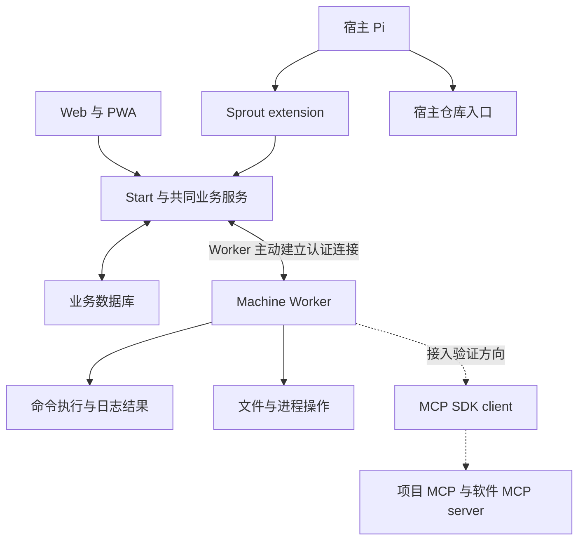

# Sprout Mio 基础架构方向

本文记录技术栈选择及架构讨论的当前结论。产品行为与分期以 [core-scope.md](core-scope.md) 为准。开发编排必须从 [开发总计划](development-plan.md)进入，功能工程依赖见 [功能开发专项计划](development-plan-functional.md)。

状态为已有 P1 与 P2 运行证据的设计基线。P0 已用最小实验验证技术栈与高风险协议，结论见 [P0 结论一览](p0/summary.md)。P1 已完成工程骨架、Human 登录与 Project 创建查询的真实验收，结论见 [P1 结论一览](p1/summary.md)。P2 已完成身份、成员、持久 DM、稳定 URL 与 Info Hub 两个已有对象视角，真实重启和两用户隔离证据见 [P2 结论一览](p2/summary.md)。完整一期产品端到端验证尚未开始。已确定的技术栈、建议采用的实现方向、待验证的选择分别记录，不将源码调查或官方文档支持标记为运行验证。

## 用框架约束常规业务开发

已选择 TanStack Start、Vite+、Drizzle ORM、Better Auth、shadcn + Base UI、Effect。选择 Start 的重要原因是约束开发路径，减少低成本 coding agent 需要自行作出的架构选择。成功率和成本收益尚未测量。

| 技术 | 职责 | 边界 |
| --- | --- | --- |
| TanStack Start | SPA、路由、server functions、server routes | 页面和外部入口调用共同业务服务，后台运行不能依附 HTTP 请求 |
| Vite+ | 开发、构建、检查、测试 | 不承担生产进程监督或作业恢复 |
| Drizzle ORM | schema、查询、事务、迁移 | 互斥和去重还需要数据库约束与明确事务 |
| Better Auth | Human 登录和 session | Worker 身份、分身身份、Project 参与权与租约另外建模 |
| shadcn + Base UI | React 组件和交互基础 | 页面行为遵守 Mio 决策，不直接复制原 Web |
| Effect | 后台并发、取消、重试、资源管理、依赖装配 | 内存 fiber 和 Queue 不替代持久记录 |

P1 已验证 `vp test run`（Vitest）与 `vp check` 的格式、lint 和类型门禁，证据见 [tooling.md](p1/tooling.md#vp-test-结论)。写入格式使用 `pnpm fmt`，CI 的 `pnpm check` 不带 `--fix`。格式配置排除 `experiments/**`、根 `docs/*.md`、`docs/p0/**`、`README.md`，以及 `drizzle/meta/**`、`src/routeTree.gen.ts`、`src/db/auth-schema.ts` 三类生成物；因此不能声称所有文档都受格式门禁约束。排除来自配置层 `fmt.ignorePatterns`，`--ignore-path` 不能覆盖它，取舍见 [格式策略与排除项](p1/tooling.md#格式策略与排除项)。

P0 发现的运行期约束已在 P1 接入。TanStack Start 的 SPA 同时设置 `spa.enabled` 与 `createStart(() => ({ defaultSsr: false }))`。`pnpm start` 显式使用 `node --env-file-if-exists=.env.local .output/server/index.mjs`，已有进程环境优先。生产入口在监听前校验 config 与有效 `BETTER_AUTH_SECRET`，完成迁移和 runtime ready；构建 prerender 通过框架标记跳过 runtime，不要求部署 secret。未知页面 GET 的 shell 404 在请求边界转为 200，API 与 server function 不做该转换。静态托管的 `_shell.html` rewrite 仍未验证，证据见 [骨架运行入口](p1/skeleton.md#运行入口) 与 [runtime 入口](p1/runtime.md#入口与单例)。server function 的授权失败在响应载荷中，不能只读 HTTP 状态码。

公开的 `pnpm build` 已在构建前删除 `.output`，防止 SPA shell 引用旧资源名。连续构建与客户端资源 hash 变化的验收见 [重构验收报告](p1/refine-report.md)。静态托管与 CDN rewrite 仍未验证。

常规功能沿着页面、server function、业务服务、数据库的固定路径实现。业务服务供 Web 与 Pi extension 的入口共同调用。外部协议使用 server routes 或所选生产适配器的网络入口，不将 Start 的内部调用协议直接作为 Worker 协议。

Effect 优先用于需要长期运行、并发和恢复的服务。React 展示和纯数据转换不必统一包装为 Effect。固定一种应用错误表示与边界转换方式，避免各功能建立自己的异常、重试和依赖框架。

### 常驻服务的形状

P3 的 Pi 会话管理是第一个常驻服务。调度器在 `src/server/pi-host/host.ts`，依赖组装在 `src/server/pi-host/index.ts`，接进 runtime 在 `src/server/runtime.ts`，快进测试在 `tests/pi-host-clock.test.ts`。后续的调度器、Worker 连接与 MCP client 沿用这套形状。

一个进程只有一个 `ManagedRuntime` 和一张 Layer。常驻服务的 Layer 用 `Layer.mergeAll` 与既有 Layer 合成，不新开第二个 runtime。第二个生命周期所有者会让停止顺序失去结构保证，只能靠调用点的手工顺序维持。

常驻纤维由 runtime 跑的 effect 派生，用 `Effect.forkIn(layerScope)` 绑到 Layer 的 Scope。在层体里用 `forkScoped` 起的纤维拿不到运行时的 Clock，这个错误只在 `TestClock` 下显形，生产里看不出来。

活跃状态放在 Scope 里，不写 `started`、`stopping`、`shutdown` 这类必须互相保持一致的标志位。Scope 关闭即中断纤维。

停止是一个有界的 effect，在 dispose 之前显式执行。停止结果用 `Effect.cached` 缓存，重复调用复用同一个结果与同一个错误，不重开第二个截止。Scope finalizer 只做同步收尾，不放等待外部响应的异步工作。finalizer 在释放区域里跑，外层超时抢占不了它。

只有调度决策走 Effect 的 Clock。轮询间隔、超时、截止与重试间隔用 `Effect.sleep` 和 `Effect.timeout*`。真实子进程与真实网络的守护超时留在边界类里。

这条边界有实测依据。`TestClock` 把同一个 2500ms 截止从 2501ms 压到 11ms，但压不动真实子进程，也不重定向 `Date.now()`。保留真实计时器只注入 `now()` 压不动调度，同一形状仍是 2536ms。测量脚本与断言在 `experiments/effect-clock-spike/`。

dispatch 另有一条取消安全约束。`prepareRun` 会起真实子进程，中断点若落在起进程与登记之间，这个子进程无人认领，停止时也不会被关闭。prepare 与登记必须在 `Effect.uninterruptible` 区里完成。

## 让运行生命周期独立于请求

Web 与后台同进程，P0 证据不支持拆出独立后台进程（[runtime-host.md](p0/runtime-host.md)）。共进程有两个前提。常驻 runtime 必须是进程级单例，用 `globalThis` 缓存 `ManagedRuntime`，模块级变量在 HMR 重新求值时会被重建并产生第二份后台工作。信号驱动的关闭必须挂在进程入口的主线程上，dev 模式下 SSR 运行在 Nitro 的 worker thread 里，模块内注册的 `process.on('SIGTERM')` 收不到进程信号。

P1 的 `src/server/server-entry.ts` 是 Nitro runtime plugin，在模块顶层等待 `startRuntime()`，避免 Nitro 不等待 plugin 回调 Promise 而提前监听。启动先校验配置与认证 secret，再迁移，在事务内把遗留活跃 boot 标为 `interrupted` 并写入新 boot，最后 ready。恢复范围是 `runtime_boot`，不代表业务作业恢复。`globalThis.sproutRuntime` 复用启动与关闭 Promise、ManagedRuntime 和 boot，真实 dev HMR 未产生第二份 runtime，证据见 [runtime 验证](p1/runtime.md#验证命令与证据)。

生产入口在 ready 后监听，主线程注册 SIGTERM 与 SIGINT，信号先进入 draining 并拒绝新工作，等待在途 HTTP 处理、响应发送与已观察到的 Node server 关闭后，才释放 Scope 的共享数据库连接，再由独立短连接写入 `stopped`。8 秒排空超时标记失败、留下 `stopping` boot 并退出 1，总关闭截止为 9 秒；真实慢上传、503 拒绝、成功退出 0 与超时退出 1 的证据见 [runtime 排空验证](p1/runtime.md#在途-http-排空补充验证)。当前 srvx 普通生产有连接关闭 listener，CI/TEST 下由入口补上同一 Node server 的 close，入口等待实际 close 事件。首次 HTTP 之前尚未观察到的半连接、WebSocket 与 dev 信号优雅关闭未验证。health 每次检查真实数据库与迁移账本，不可用返回 503；正常生产首个可连接响应已为 200，不能声称观测过监听期间的 503 到 200 窗口。调度器与 Worker 连接尚未实现，Pi 会话管理已在 P3 实现。当前 Scope 的真实资源是数据库连接与 Pi host 的常驻纤维。`runtimeSnapshot()` 的 `activeBackgroundTasks` 仍是硬编码 0，真实活跃 run 只经 `piHostSnapshot()` 暴露。请求只消费 runtime，不拥有它。

若开发热更新或生产适配器无法可靠承载后台生命周期，可以拆出后台进程，但仍复用共同业务服务和契约。不能因拆进程而复制授权逻辑或创建第二套业务事实。

SQLite + Drizzle 是单宿主部署的默认组合。driver 已由 P0 收敛为 `better-sqlite3` 同步驱动，迁移用 `drizzle-kit generate/migrate`（[stack-versions.md](p0/stack-versions.md)）。事务、唯一约束与迁移有可重跑证据，备份与恢复未验证。SQLite 约束错误在 Drizzle 里的位置不一致，查询构造器给出 `error.code`，`.run(sql\`...\`)` 要读 `error.cause.code`，约束分类不能只读一层。不要为尚未出现的多宿主需求提前增加分布式调度。

## 分开记录身份和生命周期

| 对象 | 身份与约束 | 生命周期 |
| --- | --- | --- |
| Agent profile | 人设与默认配置 | 配置变更从下一轮生效 |
| Agent 分身 | profile × Conversation 唯一 | 跨 run、跨服务重启保持身份 |
| Agent run | 属于一个分身的一轮执行 | 同一分身串行，其他分身可并行 |
| Machine lease | Project × Machine 内独占，holder 为分身 | 明确释放、交接或收回，不随 run 结束 |
| Remote execution | 稳定执行 ID，记录 Project 与 Machine | 独立于 run、宿主连接和租约动作 |
| Task | 属于 Project，由 Conversation 承接 | 保持 proposed、assigned、finished、canceled 四态 |
| Wake request | 目标分身、来源、去重身份与处理记录 | 持久恢复，执行前重新检查参与权和暂停控制 |
| Repository snapshot | 仓库来源、commit 或 ref、获取时点 | 不混同 Machine 的未推送与未提交现场 |
| MCP binding | Project、Machine、server、目标实例 | 接入预案，交付分期待单独确认 |

P2 的身份与持久数据已落实。全局 Agent profile 按创建者授权，可复用于本人多个 Project。`src/domain/access.ts` 的 `assertProjectAccess` 按 projectId 与当前 userId 查询 Project，只有创建者可访问；不存在和越权统一抛出 `not_found`，消息为「对象不存在」。通过 Conversation 或分身查询时从实际对象取得 projectId 再授权，关联查询过滤已授权 Project。两用户生产 HTTP 与页面隔离、错误 requestId 和零泄漏反证见 [独立验收](p2/acceptance.md#隔离反证与正常对照)。P2 没有运行时快照，其隔离未验证。

`agent_instance` 的 `agent_instance_profile_conversation_unique` 唯一索引覆盖 profile × Conversation，真实 SQLite 重复 INSERT 已被拒绝。`createDirectConversation` 在 IMMEDIATE 事务中复用当前 Project 与 profile 的既有 DM。Conversation 的数据库 CHECK 与契约当前只允许 `dm`。配置与人设修改不重建分身或历史，真实生产进程重启前后 conversation、instance、消息与配置逐字相等，证据见 [分身唯一性](p2/conversation-dm.md#分身身份与唯一性的实现位置) 与 [出口字面量](p2/acceptance.md#出口条件与字面量)。保存配置不代表已有真实 Pi 运行时消费配置。

Info Hub 已落实为 `src/domain/info-hub.ts` 的只读查询模块。Project hub 与对话页消费 Project 成员及其 DM 链接、Conversation 成员、分身和消息统计，不新增一级页面。查询复用已授权的领域服务；组件只消费视图。run 与 Machine、租约视角使用 `available: false` 和非空 reason，页面显示「未实现」及 P3 或 P4 原因，证据见 [模块入口](p2/info-hub.md#模块入口与边界)、[不可用标记](p2/info-hub.md#显式不可用标记的设计理由) 与 [Chromium 验证](p2/info-hub.md#验证记录)。

租约的活跃性由 `state` 列加部分唯一索引 `(project_id, machine_id) WHERE state='active'` 表达，释放行保留为审计历史。直接交接是单个事务里的释放加获取，数据库约束阻止两个活跃租约但不阻止零租约空窗，单事务协议负责不留空窗。租约授权使用持久代次，宿主与 Worker 两个方向都逐操作核验并拒绝旧代次帧。数据库更新不能单独证明 Worker 已撤销旧权限，结果不确定时保留待处理占用。

远端执行的幂等键是 `(Machine, request ID)` 且绑定命令指纹，稳定执行 ID 是独立主键。唤醒去重键的作用域是目标分身，一个去重键终身只对应一行记录，重复入队只合并，需要再次触发必须派生新的去重键。数据库连接必须逐连接显式打开 `PRAGMA foreign_keys = ON`，better-sqlite3 默认关闭。

Effect Scope 可以管理连接、订阅和本轮临时资源。run 的 Scope 结束不能自动释放业务租约，也不能结束已经提交的远端长命令。

业务变更与需要可靠处理的通知建议在同一事务中记录，再异步投递。P1 的 Project 创建已在同一 SQLite 事务写入业务行与 `project.created` 诊断，写诊断失败时整体回滚，证据见 [事务与错误路径](p1/feature-sample.md#事务与错误路径证据)。P2 的 profile、配置、成员、DM 与消息写入口同样将业务与诊断放在同一事务，真实诊断 INSERT 失败的回滚证据见 [身份数据验证](p2/identity-data.md#验证记录)。运行期的 `recordDiagnostic` 使用共享 db，捕获失败并返回 false；不能将它直接当作会传播写入失败的业务事务接口。消息已持久化，唤醒和操作记录仍未实现。前端事件通道可发送变更提示，重连后补齐事件或重新获取快照，不把内存广播当作事实来源。

基础诊断已经落到 `src/server/server-entry.ts` 的 Nitro hooks、`src/server/request-context.ts`、`src/server/diagnostics.ts` 与 `diagnostic_event` 表。Nitro 覆盖客户端传入的 requestId，把同一值交给 Project server function、响应头与 HTTP 诊断，Project 创建再关联真实 projectId。受保护的 `/api/diagnostics` 支持按 requestId 与 projectId 查询，浏览器错误页、响应头和诊断行一致性已有真实证据。认证的三个 session server functions 也复用 Nitro requestId。诊断查询要求 actorId，Project 行按创建者隔离，非 Project 行按具体 requestId 查询；HTTP 入口拒绝不带 requestId/projectId 的列举。P2 已在 `conversation.created` 关联真实 conversationId 与 instanceId，`message.sent` 关联 conversationId，agent sender 还关联实际 instanceId。诊断不保存正文、人设或配置，runId 与 executionId 仍为空，证据见 [P2 诊断与事务](p2/identity-data.md#诊断与事务)。P1 的 requestId 行为见 [requestId 与诊断](p1/runtime.md#requestid-与诊断)。

## 让 Worker 提供整机操作能力

Worker 运行在 Machine，Pi 运行在宿主。Worker 的主动连接、认证、连接代次和重连经验参考原 Sprout，具体协议按 Mio 的分身与 Project 租约重新设计。

普通命令以 Node `child_process.spawn` 为候选底座。需要交互终端时采用 `node-pty`。PTY 管理终端输入输出，不自动提供持久执行和结果恢复。

命令协议需要显式表达以下信息。

- 请求 ID、执行 ID 与关联 ID。请求 ID 是幂等键并绑定命令指纹，执行 ID 是稳定执行身份，关联 ID 把响应配回请求。重复提交返回同一执行 ID，不重复启动已确认的同一操作，同键换命令显式拒绝。
- executable 与 argv，或明确的 shell 类型及脚本。不能隐式假设所有机器都提供 bash。
- cwd、环境配置、Project 和 Machine。
- 日志游标、执行状态、退出结果和显式取消。
- 等待超时与执行超时。停止等待不默认终止远端进程。

macOS 一期验收。Windows 二期区分 PowerShell 7、Windows PowerShell 和 cmd，并报告实际路径、版本及能力。文件操作直接使用跨平台文件 API，避免依赖 shell 文本处理。

跨 run 与宿主连接持续执行是一期要求。恢复权威分三层，宿主意图 journal、Worker 执行 journal、执行端的结果文件，缺一层就有盲区，`unknown` 是一等返回态。Worker 侧执行记录与命令终态由执行端持久化，宿主只保存意图与查询点，这是响应丢失后不重跑的前提。Worker 崩溃后是否保持进程、如何取得最终退出结果，以及 Machine 重启后的恢复范围，均须在实现前写清。PID 存活不能证明结果可恢复。自动重启 Worker 不能自动重跑未知结果的命令。

开发桌面的 Worker 优先考虑用户登录 session。Windows 服务的 Session 0 与桌面软件环境不同，连接已运行的软件与启动 GUI 软件分别验收。

## 通过标准 MCP 连接项目与软件能力

本节保存接入方向，不自动改变 core-scope 的交付分期。项目 MCP、Unity MCP、Blender MCP 的纳入阶段需明确记录；支持它们不意味着接入其他 harness。

建议 Worker 使用官方 MCP TypeScript SDK 连接本机 stdio 或 Streamable HTTP server。宿主通过受 Project 与分身身份约束的 MCP endpoint 或薄 stdio bridge 暴露这些能力。Sprout extension 注册入口，复用 Pi 的 MCP 客户端。

P0 的结论是 SDK 默认不加载内置 codemode、tool_search 与 MCP extension，接入时必须用 `createMcpExtension()` 等显式注册，并且 `DefaultResourceLoader` 默认仍会扫描用户已装的 extension，需要换成受控的 loader。三个内置 extension 的 SDK 加载本身未验证。当前调查核对了 Pi 1.3.0 的 `registerMcpServer`、`unregisterMcpServer`、resources 和完整工具结果支持。实施时锁定实际版本。

MCP binding 区分 Worker 启动的 stdio 进程与外部已运行的 HTTP 服务。启动路径、cwd、环境和凭据在 Machine 解析。导入客户端配置后转换为 Mio 的明确模型，不盲目执行仓库中新增的 server 配置。

Unity MCP 优先验证 HTTP 模式，将 Project checkout 与具体 Editor 实例绑定。实例消失时返回不可用，不自动改投默认 Editor。Blender MCP 使用 Python server 的标准 MCP 接口，再由其连接 addon。Sprout 不重写软件内部桥接协议。

授权在每次远端操作时核验，不能只在发现工具时核验。session、工具名和执行 ID 不构成操作权。租约交接后旧持有者不能使用已缓存入口绕过授权。

桥接层保留图片、structuredContent、资源引用与目录变更。远端文件路径不得作为宿主路径解释。prompts、sampling、elicitation 等能力按端到端实际支持情况声明，不宣称透明支持全部 MCP 特性。

FastMCP proxy 可作为备选，但需要处理新建 session 与共享 session 的不同语义。Unity 的活动实例选择不能依赖会被代理丢弃或被其他调用者修改的 session 状态。

通用 MCP 的副作用不保证幂等。可能已执行但结果丢失时返回未知，先查事实，不盲目重试。多个 Projects 共用同一物理软件实例时仍可能互相影响，Sprout 不增加跨 Project 资源仲裁或 OS 隔离承诺。

## 按能力借鉴原 Sprout

原仓库为 [tinysnake/sprout](https://github.com/tinysnake/sprout)。下列路径相对于原仓库。每项实施前重新阅读当时源码并记录参考 commit，不把调查时的行为当作永久事实。

| 原模块 | 保留的经验 | 必须重判的内容 |
| --- | --- | --- |
| `src/worker/gateway.ts` | 主动连接、身份认证、连接代次 | Mio 授权绑定与恢复同步 |
| `src/worker/recovery-journal.ts` | 顺序确认、拒绝过期状态、未知结果 | turn、engine、Task context 与远端命令的差异 |
| `src/engine/pi-host.ts` | 会话准备、readiness、恢复标识 | 分身身份、宿主配置继承、当前 Pi API（接入时重新对齐 Pi 1.3.0 的 `createAgentSession`、`SessionManager`、`ModelRuntime` 签名） |
| `src/environment/pool.ts` | 互斥和冲突处理经验 | run/task holder、TTL、读写租约与 Mio 不同 |
| `src/run/orchestrator.ts` | 启停和异常处理场景 | run、Task、租约的旧联动 |
| `src/worker/project-mcp.ts` | 操作身份、授权门禁、未知结果 | 手写协议、文本结果限制、内存去重、旧 holder 模型 |
| 原 Web | 实际操作流程与布局经验 | Vue 实现和旧业务规则，不直接迁入 React |

每个复用任务记录旧实现、新规则、采用部分、删除部分与验收证据。旧测试按新行为筛选，不以旧断言全部通过作为重制完成条件。

## 待验证的架构选择

| 问题 | 验证阶段 | 决策所需证据 |
| --- | --- | --- |
| Start 与常驻 runtime 是否共进程 | P0 | HMR、生产构建、长连接、重启与关闭实验 |
| SQLite driver 与迁移方式 | P0 | 事务、唯一约束、备份恢复、构建兼容 |
| Pi 接入与配置继承 | P0、P3 | 真实 session、下一轮配置、当前轮投递、停止与恢复 |
| Worker 重启后执行恢复范围 | P0、P4 | 中断位置与日志、结果、未知状态的对应关系 |
| 直接交接与撤权协议 | P0、P4 | 丢包、旧请求、重连、并发交接的可重复实验 |
| Jev 与 Task 小脑关系 | P6 | 中文样本、失败回退、重复唤醒、人类控制 |
| 软件 MCP 接入分期与能力 | R1 | Unity 多实例、Blender 图片、重连与撤权实验 |

P0 已收敛上表前五项的本机结论。Start 与常驻 runtime 共进程成立。SQLite driver 为 `better-sqlite3`。Pi 接入用 SDK 并跑在宿主管理的子进程里，前提是显式 `ModelRuntime` 与显式 `model`，裸 factory 会解析到错误的 provider 且失败不抛异常，只写 `stopReason`（[pi-integration.md](p0/pi-integration.md)）。Worker 重启恢复范围与直接交接协议的语义用原型验证（[recovery-promises.md](p0/recovery-promises.md)、[contracts.md](p0/contracts.md)），真实 macOS Worker 端到端与真实撤权留到 P4 验收。

## 已查阅的主要资料

以下资料支持组件能力判断，不代表 Mio 已完成集成验证。

- [TanStack Start SPA mode](https://tanstack.com/start/latest/docs/framework/react/guide/spa-mode)。
- [TanStack Start server entry point](https://tanstack.com/start/latest/docs/framework/react/guide/server-entry-point)。
- [Vite+ monorepo](https://viteplus.dev/guide/monorepo)。
- [Better Auth 与 Start](https://www.better-auth.com/docs/integrations/tanstack)、[Drizzle adapter](https://www.better-auth.com/docs/adapters/drizzle)。
- [Drizzle transactions](https://orm.drizzle.team/docs/transactions)。
- [Effect Scope](https://effect.website/docs/resource-management/scope/)。
- [Node child_process](https://nodejs.org/api/child_process.html)、[node-pty](https://github.com/microsoft/node-pty)。
- [Coder 可重连终端](https://coder.com/docs/user-guides/workspace-access/web-terminal)、[E2B 后台命令](https://docs.e2b.dev/commands/background)。
- [MCP TypeScript SDK](https://github.com/modelcontextprotocol/typescript-sdk)、[FastMCP proxy](https://gofastmcp.com/servers/providers/proxy)。
- [Unity MCP transports](https://coplaydev.github.io/unity-mcp/architecture/transports)、[instance routing](https://coplaydev.github.io/unity-mcp/architecture/instance-routing)。
- [Blender MCP](https://github.com/ahujasid/blender-mcp)。
- [Windows interactive services](https://learn.microsoft.com/en-us/windows/win32/services/interactive-services)。
