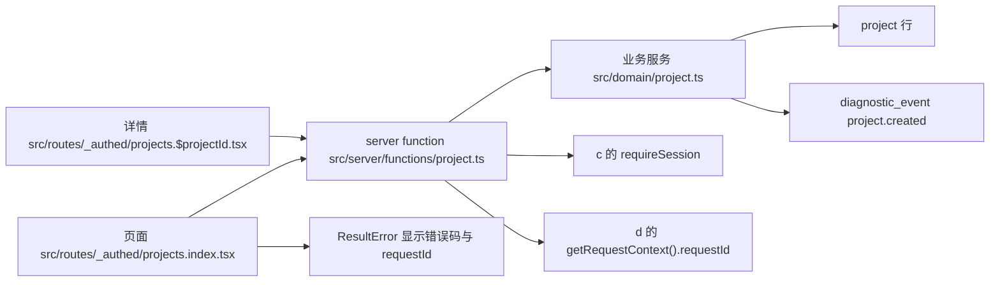

# 功能样例：Project 的创建与查询

本 unit 交付 P1 的标准功能。它是一条真实可跑通的链路，也是后续 Agent 写新功能的模板：页面调用 server function，server function 在边界解析输入，业务服务在单个事务里写业务行与诊断行。范围只覆盖 Project 的创建、列表与详情，不做配置、成员、授权、分页与排序。

## 分层与数据流



| 层       | 文件                                         | 职责                                                                                  |
| -------- | -------------------------------------------- | ------------------------------------------------------------------------------------- |
| 契约     | `src/contracts/project.ts`                   | `createProjectInput`、`Project`、`projectIdInput`、`fieldErrorsFrom`、`ProjectResult` |
| 路由     | `src/routes/_authed.tsx`                     | 受保护布局，未登录重定向 `/login`，登出入口                                           |
| 页面     | `src/routes/_authed/projects.index.tsx`      | 列表与新建对话框（loader 调 `listProjectsFn`）                                        |
| 页面     | `src/routes/_authed/projects.$projectId.tsx` | 详情（loader 调 `getProjectFn`）                                                      |
| 组件     | `src/components/project/**`                  | 新建对话框与失败/字段错误呈现                                                         |
| 边界     | `src/server/functions/project.ts`            | 会话、zod、AppResult 转换，导出 TanStack server function 与可直接测试的 boundary 函数 |
| 业务服务 | `src/domain/project.ts`                      | `createProject`、`listProjects`、`getProject`，事务与领域错误                         |
| 数据库   | c 的 `src/db`                                | `project`、`diagnostic_event` 表                                                      |
| 诊断     | d 的 `src/server/diagnostics.ts`             | 按调用者归属及 `requestId`/`projectId` 查询事件                                       |

关键数据形状。

- `ProjectContext = { userId, requestId }`。业务服务只接收已解析的输入和调用者身份，不接触 HTTP、session 或 header。
- `Project` 由 `projectSchema` 推导，`createdAt`/`updatedAt` 是 ISO 字符串，跨边界前在 `toProject` 里从秒级时间戳转换。
- `ProjectResult<T> = AppResult<T> & { fieldErrors?: Record<string, string> }`。这是本 unit 对 `src/contracts/project.ts` 的向后兼容扩展：`ok` 判别字段和两个分支不变，只在失败时多一个可选的字段错误映射，供表单显示在输入旁。
- `ProjectError` 是业务服务的失败类型，当前只有 `not_found`。其余异常由边界映射为 `internal` 并脱敏，服务端记录真实原因与 `project.request_failed` 诊断。

`createProject` 的顺序固定为：写 `project` 行，调用测试注入 hook，写 `diagnostic_event`（`event: 'project.created'`，带同一 `requestId` 与 `projectId`）。三步在同一 `sqlite.transaction` 内，任一步抛错整体回滚。业务服务直接写诊断表而不是调用 `recordDiagnostic`，因为 `recordDiagnostic` 使用共享 db，却会捕获写入失败并返回 false；直接写表才能把失败传播给本次事务并触发回滚。

边界顺序固定为：`requireSession` → `createProjectInput.safeParse` → 事务。依赖只加载一次，加载与这三个步骤共享一个 try，session 基础设施异常也转换为当前 requestId 的 internal 载荷。失败一律 HTTP 200，错误在载荷里，响应头是 `x-sprout-request-id`。认证 server functions 现也复用同一个请求上下文。

诊断查询要求 actorId；Project 行只能由创建者读取，非 Project 行必须按具体 requestId 查询。HTTP 查询必须提供 requestId 或 projectId。下列历史输出保留原观测值，当前补充验证见 [重构验收报告](refine-report.md)。

## 真实命令与输出摘要

命令都在 `worktrees/p1-e-project` 执行，`localhost` 请求使用 `curl --noproxy '*'`。

| 命令                                    | 状态         | 输出摘要与产物                                                                                                                                                                                                         |
| --------------------------------------- | ------------ | ---------------------------------------------------------------------------------------------------------------------------------------------------------------------------------------------------------------------- |
| `bash scripts/verify/e-project.sh`      | PASS，已验证 | 干净构建、生产启动、curl 注册、创建成功与失败、`/api/diagnostics` 关联、`not_found`、Chromium 12/12、SIGTERM 退出 0。证据在 `.verify/e-project/`（`evidence.json`、`server.log`、`browser.log`、请求 body 与 headers） |
| `node scripts/browser/project-flow.mjs` | PASS，已验证 | 12/12，含刷新保持同一 Project、后退/前进、空名与超长描述字段错误、`not_found`、登出重定向                                                                                                                              |
| `pnpm check`                            | PASS，已验证 | lint、格式与三份 tsconfig 类型检查退出 0                                                                                                                                                                               |
| `pnpm test`                             | PASS，已验证 | 6 个文件 29 个测试通过，含 `tests/project.test.ts` 的 6 项                                                                                                                                                             |
| `bash scripts/verify.sh`                | PASS，已验证 | 聚合 a、b、c、d、e 五个脚本，全部 PASS                                                                                                                                                                                 |

`bash scripts/verify/e-project.sh` 的实际输出。

```text
PASS pnpm build {"shell":".output/public/_shell.html","referenced":["index-BU4X8Tyl.js", ...]}
PASS production server ready {"requestId":"req_d57a190d-3521-4b38-888c-717fd1fcf1c0","bootId":"boot_055522a7-cf9a-4707-a34b-de4bcc33ca7d","version":"0.1.0"}
PASS curl 注册并保存会话 cookie（带 Origin） {"status":200,"cookies":"cookies.txt"}
PASS server function 创建成功并写回 project.created {"projectId":"prj_60f96166-6c64-40ed-873e-64ca44de6497","requestId":"req_8041881b-9ab4-4d3b-8e7d-e1b835aed295","event":"project.created","message":"Project 已创建"}
PASS server function 校验失败走 HTTP 200 载荷内错误 {"status":200,"requestId":"req_60a5a41f-7fdb-4e70-8a23-4a52cf178693","fields":["name","description"]}
PASS 未登录调用返回 unauthorized {"status":200,"requestId":"req_8b5a17ce-df15-4c5c-9126-8c8d50c7a5cb"}
PASS 不存在的 project id 返回 not_found {"status":200,"requestId":"req_0b00fc97-adde-4750-b1c7-d405c35e488c"}
PASS 真实 Chromium 流程 {"log":"browser.log","screenshots":"docs/p1/evidence/*.png"}
PASS 生产进程 SIGTERM 退出 {"code":0,"signal":null}
```

`node scripts/browser/project-flow.mjs` 的实际输出。

```text
PASS register_sets_session :: 注册后经首页落到 /projects
PASS sign_out_returns_to_login :: 登出后落到 /login
PASS login_opens_protected_area :: 登录后经首页落到 /projects，列表为空
PASS create_project_appears_in_list :: 列表包含 ["验收样例 1792230730231"]
PASS open_detail_shows_fields_and_request_id :: 详情 {"name":"验收样例 1792230730231","description":"浏览器验收创建的分层样例","createdAt":"2026-10-17T09:52:11.000Z","requestId":"req_a994dc9d-0397-4ea2-b864-36ffa8da9759","path":"/projects/prj_34e3096e-fa4c-4891-8d02-449c3731c598"}
PASS reload_keeps_same_project :: 刷新后仍是 验收样例 1792230730231，URL http://localhost:3141/projects/prj_34e3096e-fa4c-4891-8d02-449c3731c598
PASS history_back_and_forward_keep_target :: 后退到 /projects，前进回 /projects/prj_34e3096e-fa4c-4891-8d02-449c3731c598
PASS empty_name_shows_field_error_and_request_id :: 字段错误 "名称不能为空"，页面 requestId req_38961afa-6b93-4325-b910-990a33d1ba7f、响应头 req_38961afa-6b93-4325-b910-990a33d1ba7f 与诊断行一致
PASS long_description_shows_field_error :: 描述字段错误 "描述最多 500 字"
PASS missing_project_shows_not_found :: 不存在的 id 显示 {"message":"Project 不存在","meta":"not_found · req_28730c3a-54c5-41f2-a9e7-632aa732dd6f"}
PASS signed_out_visit_redirects_to_login :: /projects 落到 /login
PASS no_console_errors :: 无 console.error 与未捕获异常
browser checks: 12/12 passed
```

## 截图

| 文件                                         | 内容                                                   |
| -------------------------------------------- | ------------------------------------------------------ |
| `docs/p1/evidence/project-create-dialog.png` | 新建对话框，含名称与描述输入                           |
| `docs/p1/evidence/project-created.png`       | 创建成功后列表可见新建的「验收样例」                   |
| `docs/p1/evidence/project-detail.png`        | 详情页：名称、描述、创建时间、requestId                |
| `docs/p1/evidence/project-error.png`         | 空名称提交：字段错误、`validation_failed` 与 requestId |
| `docs/p1/evidence/project-not-found.png`     | 不存在的 id：`not_found` 与 requestId                  |

## 事务与错误路径证据

事务证据来自真实 SQLite，不是 mock。

- `tests/project.test.ts` 在临时库上注册真实会话，调用 `createProjectBoundary` 创建成功，断言 `project` 与 `diagnostic_event` 各 1 行且 `project_id` 相同、`request_id` 为本次请求值。
- 同一测试用 `createProject(..., { afterProjectInsert: () => { throw } })` 触发强制失败，断言 `project` 与 `diagnostic_event` 计数与失败前完全一致，即两行都没有留下。
- 边界级断言覆盖：空名称与 501 字描述返回 `validation_failed` 且 `fieldErrors` 恰好为 `name`、`description`；无会话返回 `unauthorized`；不存在的 id 返回 `not_found`。三种失败的 `requestId` 都是传入的当前请求值。
- `scripts/verify/e-project.sh` 在真实 HTTP 上重复了同样的路径：creator 的响应头 requestId 与 `/api/diagnostics?requestId=` 查回的 `project.created` 行一致，且该行的 `projectId` 等于创建载荷中的 `prj_*`；校验失败载荷不含 `prj_`，证明失败请求没有写业务行。
- 浏览器流程在同一次空名提交里比对三处 requestId：页面错误载荷显示的 `req_*`、server function 响应的 `x-sprout-request-id` 头，以及用该 id 调 `/api/diagnostics` 查回的诊断行（`http.response`），三者相等。不存在的 id 显示 `not_found` 与当前请求的 `req_*`。

## 未验证项

- 多用户隔离只由 `createdBy` 过滤实现，没有授权模型，也没有第二个用户的端到端用例。列表与详情按 `createdBy` 过滤是当前实现，不是冻结契约。
- 秒级时间戳：`project` 表按冻结契约用 `unixepoch()` 整数，重建的 `createdAt` 精确到秒，创建响应的 ISO 字符串已按秒取整，不做毫秒断言。
- 并发创建、并发事务冲突与高负载下的诊断写入未测。
- CI 上没有 Chromium：`.github/workflows` 不由本 unit 修改，浏览器验收在本地与 coordinator 机器上执行。
- 历史上残留 `.output` 会留下旧资源引用；现已由公开 `pnpm build` 的前置清理修复，连续构建与资源 hash 变化的证据见 [重构验收报告](refine-report.md)。静态托管与 CDN rewrite 仍未验证。
- `scripts/browser/project-flow.mjs` 依赖 server function 的固定函数 id 之外的部分不依赖内部协议；`scripts/verify/e-project.sh` 用 curl 直接调用 `/_serverFn/<id>`，请求体按 Seroval CrossJSON 手工编码，从 `.output/server` 提取 id。升级 TanStack Start 后这两处需要重新核对。

## 偏离 brief 之处

- `docs/p1/conventions.md` 的「新增功能的步骤」按真实样例改写，并补上本次实际踩到的规则；没有新增重复章节。
- `src/contracts/project.ts` 增加了 `projectIdInput`、`ProjectResult`、`FieldErrors`、`fieldErrorsFrom` 与两条中文错误消息。`createProjectInput` 的字段与约束未变，`.success` 语义未变，`Project` 类型未变。
- `src/routes/_authed/projects.tsx` 只作为布局（渲染 `Outlet`），列表移到 `src/routes/_authed/projects.index.tsx`。父路由不渲染 `Outlet` 时子路由不会出现，这是执行中发现并修正的问题。
- `src/routes/index.tsx` 保留 a 的已登录首页，只加了一个指向 `/projects` 的入口链接。把它改成直接重定向会让 `scripts/verify/c-data-auth.sh` 的 Chromium 检查失去 `/` 上的 `已登录，<姓名>` 文案而失败，因此不做该改动。
- `getProjectFn` 用 POST 而不是 GET。server function 的 GET 把载荷编码进 query string，本 unit 的 curl 路径需要可读的 JSON 请求体。
