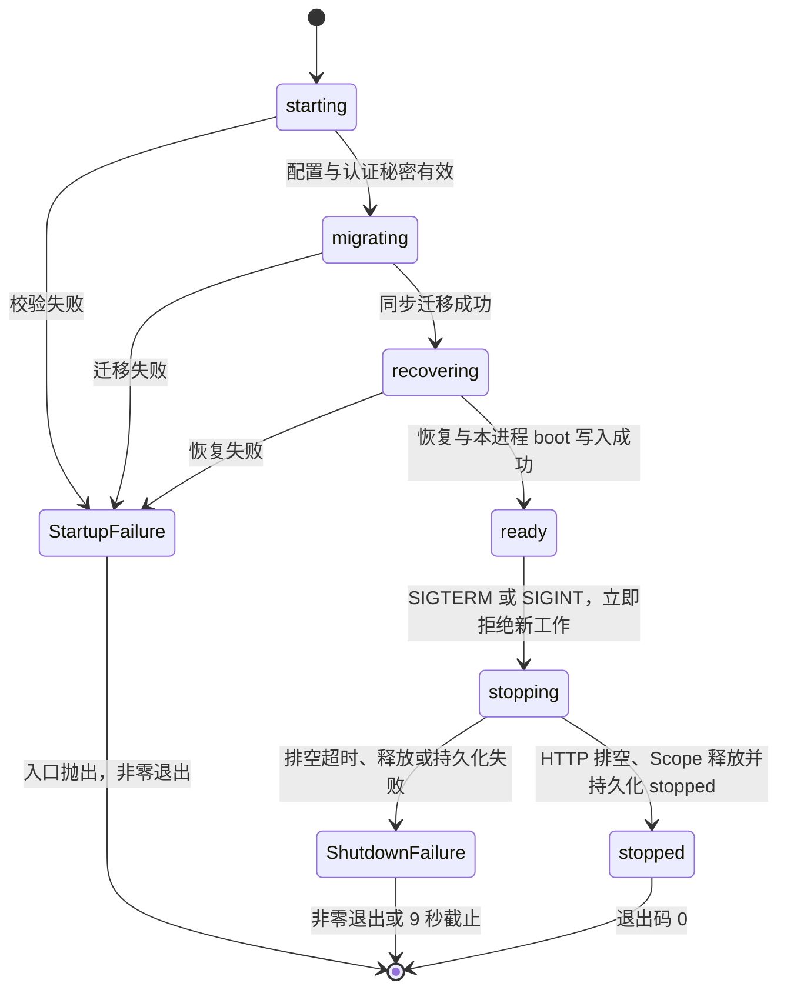

# Runtime 启动、请求与关闭

宿主 runtime 在 Nitro 入口启动。入口在配置、认证秘密、迁移和恢复通过后才监听。HTTP 请求不创建 runtime，只读取快照或等待 `runtimeReady`。持久事实位于 SQLite，`globalThis` 快照只描述当前进程。

生产启动设置 `NODE_ENV=production`，并提供有效的 `BETTER_AUTH_SECRET`。secret 必须至少 32 字符，不能使用示例占位值。缺失时，入口在监听前打印可读校验错误并以非零码退出。测试与 CI 使用显式测试值，不提交真实密钥。

## 阶段与保证



各阶段的保证如下。表中的非零退出指生产入口。dev worker 的模块错误由 Nitro 开发服务器处理。

| 阶段         | 保证                                                                                                                | 失败行为                                                                                     |
| ------------ | ------------------------------------------------------------------------------------------------------------------- | -------------------------------------------------------------------------------------------- |
| `starting`   | 解析六项 config，导入 auth 并要求有效 secret                                                                        | 记录失败阶段和可读错误，ready Promise 拒绝，入口非零退出                                     |
| `migrating`  | 调用 c 的同步 `migrateDatabase()`，迁移连接总会关闭                                                                 | 记录失败，入口拒绝监听                                                                       |
| `recovering` | 一个 SQLite 事务把旧 `starting`、`ready`、`stopping` 行标为 `interrupted`，逐行写诊断，并插入自己的 `starting` boot | 任一恢复诊断写入失败则回滚，释放已有 Scope，入口非零退出                                     |
| `ready`      | 本进程 boot 为 `ready`，Scope 持有共享应用数据库连接，ready Promise 完成                                            | health 每次重新探测数据库，数据库不健康时返回 503                                            |
| `stopping`   | 入口已 draining，boot 为 `stopping`，等待在途 HTTP 处理与响应结束，再释放 Effect ManagedRuntime                     | 8 秒排空或 9 秒关闭截止失败，phase history 标记 failed，以 1 退出，留下 stopping boot 供恢复 |
| `stopped`    | Scope 已释放，独立短连接已写入 `stopped_at` 和 `stopped`                                                            | 写入失败不能声明 stopped                                                                     |

`runtimeSnapshot().history` 为每个阶段保存 ISO 开始时间、完成时间、`running`、`ok` 或 `failed` 结果，以及失败消息。阶段进入时间也写入进程日志。`runtime.ready` 诊断保存启动阶段历史。它不替代 `runtime_boot` 的持久状态。

`runtime_boot` 的冻结 schema 没有 `migrating` 和 `recovering` 值。内存阶段保持完整，持久 boot 在迁移完成后的恢复事务中插入为 `starting`，随后变成 `ready`。不改 schema。

## 入口与单例

`RuntimeState` 在 `globalThis.sproutRuntime` 缓存 ready、启动和关闭 Promise，以及 Effect ManagedRuntime。重复调用 `startRuntime()` 返回同一个 Promise。模块重新求值复用同一实例、同一 boot 和同一 Scope。`shutdownRuntime(reason)` 同样幂等。

`vite.config.ts` 将 `src/server/server-entry.ts` 注册为 Nitro runtime plugin。当前 Nitro 静态导入 plugins，但不等待 plugin 回调返回的 Promise。因此 `server-entry.ts` 在模块顶层 `await startRuntime()`。plugin 回调只注册请求、响应与关闭 hooks。TanStack prerender 使用 Vite preview，并设置 `TSS_PRERENDERING=true`。入口识别该框架标记并跳过 runtime 启动，构建不要求部署秘密。Nitro 的 `import.meta.prerender` 不覆盖这条 TanStack 构建路径。

对照设计是在 HTTP 导入时启动 runtime。该设计无法修复监听前不加载应用的缺口，因而未采用。入口持有生命周期，路由只消费生命周期。

`runtimeReady` 的导出本身只创建一个等待 Promise，不执行迁移或启动 Scope。`GET /api/health` 不等待它，能返回当前不可用状态。其他请求在 Nitro request hook 等待它。

生产入口在 ready 后才监听，所以正常启动的首个可连接 health 响应为 200。启动前的 503 和关闭后的 503 由真实 SQLite 行为测试覆盖。生产验证不声称观察到了一个监听期间的 503 到 200 窗口。

## requestId 与诊断

Nitro fetch 边界为每个请求生成 `req_*`，覆盖客户端传入的 `x-sprout-request-id`。该值随 Request headers 进入 TanStack 上下文。response hook 把同一值写入响应头，并在非 draining 期间同步记录一条 `http.response` 诊断。诊断模块在入口顶层加载完成，hook 不异步导入，排空期间不写该诊断。该诊断只包含 method、pathname 和 status，不记录 query、cookie 或 body。

server function 通过 `getRequestContext().requestId` 获取当前值。直接持有 Request 的路由调用 `getRequestContext(request)`。这些函数要求请求已经通过 Nitro 边界，不会另造一个与响应头不同的 ID。e 的调用方式如下。

```ts
const { requestId } = getRequestContext();
recordDiagnostic({
  level: "info",
  event: "project.created",
  requestId,
  projectId,
  message: "Project 已创建",
});
return ok(project, requestId);
```

`recordDiagnostic(input: DiagnosticInput): boolean` 接受冻结 `DiagnosticEvent` 去掉 `id`、`at` 后的字段。必填 `level`、`event`、`requestId`、`message`。可选 `projectId`、`conversationId`、`instanceId`、`runId`、`executionId`、`data`。不存在的业务关联不填写。函数生成 `diag_*`，写入真实 SQLite，返回成功与否。写入失败只落 stderr，不抛给业务请求。

`queryDiagnostics({ actorId, requestId?, projectId?, limit? })` 按条件相交查询最近事件，默认 50 条。actorId 必填，Project 行必须归属于该创建者；非 Project 行必须按具体 requestId 查询。HTTP 边界限制 `limit` 为 1 到 200。时间以 ISO 返回，data 以对象返回。

`GET /api/diagnostics` 先调用 c 的 `requireSession(headers, requestId)`。未登录返回 HTTP 401 和 `unauthorized` AppResult。非法过滤条件或未提供 requestId/projectId 返回 HTTP 400 和 `validation_failed`。认证成功后将 session.userId 作为 actorId 传给查询，越权 Project 过滤返回空。成功返回 `ok(events, requestId)`。内部错误通过 `fail(toAppError(error, requestId))` 脱敏。

`AppResult<T>` 成功分支含 `ok: true`、`data`、`requestId`。失败分支含 `ok: false`、`error`、`requestId`。e 应按 `result.ok` 判别，并复用当前 requestId。后续重构已将 c 的三个 session server functions 统一到请求上下文，成功会话查询与失败登录的载荷、响应头、HTTP 诊断一致性由 `scripts/verify/c-data-auth.sh` 断言。

## health 与真实数据库

`GET /api/health` 返回 `ok`、`ready`、`phase`、`bootId`、`requestId`、`version` 和 `database: { ok, migrationApplied }`。每次执行 `SELECT 1`，并读取 `__drizzle_migrations` 的记录数。必须 ready 且两项数据库检查通过才返回 HTTP 200，否则返回 HTTP 503。响应禁止缓存。

## 信号与关闭

生产 plugin 在主线程注册一次 SIGTERM、SIGINT。首次信号立即设为 draining，重复信号复用关闭工作。关闭按以下顺序执行。

1. fetch 边界停止接收新工作；后到请求直接返回 503、requestId、`Connection: close`、`Retry-After: 1` 与禁止缓存响应，不进入路由或访问 DB。等待已经开始的启动完成，进入 `stopping` 并持久化 boot phase。
2. 在从信号开始的 8 秒期限内等待在途请求归零和已观察到的 Node server 发出 `close`。请求在调用应用 fetch 前计数，在 `finally` 标记处理结束；只有处理结束且 Node 响应 `finish` 或 `close` 后才释放计数。错误、短路和客户端断开均走同一释放路径；断开不能提前释放仍在异步执行的业务。response hook 发生在发送前，不能代替这个完成边界。
3. 排空完成后才调用 `shutdownRuntime()`。`ManagedRuntime.dispose()` 关闭 Scope，finalizer 关闭共享应用数据库连接，资源计数归零。
4. 打开独立短连接，把当前 boot 写成 `stopped` 并写入 `stopped_at`，关闭短连接，进入 `stopped`，入口以 0 退出。

排空超时记录 `HTTP 排空超时 (8000ms)`，当前 phase history 的 result 为 failed，退出 1，不调用 dispose 或写 stopped。持久 schema 没有 failed phase，boot 留在 `stopping`，下次启动恢复为 `interrupted`。释放或 stopped 持久化失败同样退出 1。总关闭截止保持 9 秒；这些是事件循环定时器，不能抢占阻塞 JavaScript 的同步操作。Nitro `close` hook 复用同一个排空 Promise。当前 Node preset 不调用该应用 close hook，生产信号保证来自主线程 handler。

锁定 Nitro `3.0.260610-beta` 的 Node preset 把 `tracingSrvxPlugins` 传给 srvx `0.11.22`。srvx Node adapter 在用户 plugins 之外直接调用 `gracefulShutdownPlugin`，普通生产启动确实注册 SIGTERM/SIGINT；`CI` 或 `TEST` 非空时不注册。它调用 `server.close()` 并等待连接，但默认 5 秒后强制断连接，也不负责应用 DB 释放或进程退出。入口把无效或小于 10 的 `SERVER_SHUTDOWN_TIMEOUT` 提升为 10 秒，避免它在应用 8/9 秒截止之前截断请求。

Nitro preset 的 srvx 句柄是局部变量。当前 Node adapter 在 `request.runtime.node` 提供原生 req/res；入口从已接收请求的 `req.socket.server` 观察 Node server 的 `close` 事件。该 Socket 属性依赖当前 Node 实现，并非稳定的跨适配器 API。排空在 microtask 中检查 server：先让 srvx 的信号 listener 调用 close，若尚未停止监听（包括 CI/TEST 禁用 srvx listener），应用调用同一个 Node server.close。等待真实 close 事件，不把已在关闭的 srvx.close Promise 当作排空证明，避免两个 handler 竞争而提前退出。应用计数同时保护客户端已断开但业务仍在执行的请求。

至少有一个 HTTP 请求进入边界后，已观察到的 server.close 还会等待该 server 上未完成的连接。尚无任何 HTTP 请求进入边界时无法取得 server 句柄：此时未进入 request 边界的半连接不在应用保证中，普通生产由 srvx 尝试关闭，入口不声明等待它们排空。WebSocket、其他适配器、内部 fetch 的传输、脱离请求的异步业务和多进程均不属于这里的 HTTP/1.1 保证。

dev 的 Nitro 与 SSR 模块在同一个 worker thread 中执行。该线程的模块入口不注册进程信号 handler。dev 进程组能退出，但本 unit 不声明 dev 的 Scope 优雅释放成立。需要主线程向 worker 传递关闭请求的后续接线。没有创建后台队列、cron 或占位任务，`activeBackgroundTasks` 为 0，Scope 的真实资源为数据库连接。

## 验证命令与证据

所有命令在 `worktrees/p1-d-runtime` 执行。localhost 请求使用 `curl --noproxy '*'`。可重跑入口如下。

```sh
bash scripts/verify/d-runtime.sh
pnpm check
pnpm test
bash scripts/verify.sh
```

a-base、b-tooling 在各自的生产启动块显式 export 同一个固定测试 secret，CI Production smoke 的 env 使用相同测试值。a-base 后续的 dev 检查继承该脚本的测试环境。变量不传播回聚合脚本的进程，调用者无需额外设置 secret。c-data-auth、d-runtime 自建随机测试 secret 和独立 SQLite 文件。日志、HTTP body、headers 和汇总位于 `.verify/d-runtime/`。测试的临时数据库位于 `.verify/runtime-test-*` 和 `.verify/diagnostics-test-*`，测试结束后清理。

已执行的命令与结果如下。

| 命令或检查                                                              | 状态             | 输出摘要与产物                                                                                                                                                                 |
| ----------------------------------------------------------------------- | ---------------- | ------------------------------------------------------------------------------------------------------------------------------------------------------------------------------ |
| 移除 plugin 注册后运行 `bash scripts/verify/d-runtime.sh`               | 已验证修复前回归 | `PORT=abc pnpm start` 仍打印 `Listening on: http://localhost:3134/`，检查因进程超过 15 秒未退出而失败。日志位于 `.verify/d-runtime-red/invalid-port.log` 与 `verification.log` |
| 恢复注册后运行 `bash scripts/verify/d-runtime.sh`                       | PASS，已验证     | 全部检查通过，汇总为 `.verify/d-runtime/evidence.json`                                                                                                                         |
| `pnpm build`                                                            | PASS，已验证     | 真实 Nitro 产物 `.output/server/index.mjs`，未提供 auth secret 时仍退出 0，日志无 runtime 阶段且数据库无 boot 行                                                               |
| `PORT=abc pnpm start`                                                   | PASS，已验证     | 退出 1，错误包含 PORT 和 `环境变量校验失败`，未监听。`invalid-port.log`                                                                                                        |
| 空 secret、短 secret、示例占位 secret 下 `pnpm start`                   | PASS，已验证     | 各退出 1，错误包含 BETTER_AUTH_SECRET，未监听。对应 `*-secret.log`                                                                                                             |
| 迁移元数据损坏、缺失 runtime_boot 表下 `pnpm start`                     | PASS，已验证     | 分别在 migrating、recovering 记录可读失败并退出 1，均未监听。`migrating-failure.log` 与 `recovering-failure.log`                                                               |
| 合法 config 下 `pnpm start` 与两个 health 请求                          | PASS，已验证     | HTTP 200，version 为 `0.1.0`，数据库两项为 true，boot 为 `ready`。两个 requestId 不同，body、headers 和诊断行一致                                                              |
| `kill -TERM` 生产进程组                                                 | PASS，已验证     | 10 秒内退出，退出码 0，boot 为 `stopped` 且 `stopped_at` 非空。日志顺序为 `stopping`、`scope-disposed`、`stopped`                                                              |
| 插入 `boot_abandoned` 后再次启动                                        | PASS，已验证     | 旧 `ready` 行变成 `interrupted`，诊断恰好 1 条，新 boot 正常 ready、关闭后 stopped                                                                                             |
| diagnostics 登录与过滤                                                  | PASS，已验证     | 匿名为 401 unauthorized；真实注册 session 后按 requestId 和 projectId 查询成功；limit 201 为 400 validation_failed                                                             |
| `pnpm exec vp test run tests/runtime.test.ts tests/diagnostics.test.ts` | PASS，已验证     | 7 个行为测试，包括启动前 health 503、ready 后 200、迁移表不可用时再次 503、幂等恢复、单例、关闭、诊断查回与非致命写入失败                                                      |
| dev 启动并修改 runtime 源文件                                           | PASS，已验证     | moduleEvals 从 2 增为 4，bootId 不变，constructions 保持 1，activeResources 保持 1，后台任务数保持 0。`dev.log` 与 `dev-health-*.json`                                         |
| `pnpm check`                                                            | PASS，已验证     | 54 个文件格式通过，39 个文件无 lint 或类型错误，退出 0                                                                                                                         |
| `pnpm test`                                                             | PASS，已验证     | 5 个文件、23 个测试通过，退出 0                                                                                                                                                |
| `bash scripts/verify.sh`                                                | PASS，已验证     | 调用环境未提供 secret，四个 unit 一次跑完，输出 `Verification scripts=4 failed=0`，退出 0。完整日志为 `.verify/d-runtime/all-verify.log`                                       |

整体回归的汇总输出如下。执行时未在调用环境提供 `BETTER_AUTH_SECRET`。

```text
PASS scripts/verify/a-base.sh
PASS scripts/verify/b-tooling.sh
PASS scripts/verify/c-data-auth.sh
PASS scripts/verify/d-runtime.sh
Verification scripts=4 failed=0
```

两条配置启动缺口已由本 unit 关闭，归属为 `owner=p1-d-runtime`。c-data-auth 以 `CLOSED invalid config startup` 记录状态，保留真实 exit、signal 和日志路径，不新增断言。当前 bad-port 与 missing-secret 的观测均为 `exit=1 signal=null`。

断言仍归 `scripts/verify/d-runtime.sh`。断言清单包括 invalid-port、missing-secret、short-secret、placeholder-secret 四种非法配置非零退出且未被超时杀死，以及 migrating、recovering 故障退出 1；这些情况均断言未监听。协调者本次整体回归已确认缺口关闭，`scripts/verify.sh` 的结果为 4 scripts、0 failed，即 `Verification scripts=4 failed=0`。

## 在途 HTTP 排空补充验证

历史 SIGTERM 证据只验证空闲关闭，未证明在途请求安全；该缺口由 [排空报告](graceful-drain-report.md) 的新 HTTP 证据补充。复跑 `bash scripts/verify/drain-http.sh` 会清理产物并构建，再运行真实生产 HTTP/1.1；已有同版本构建时可设 `SPROUT_VERIFY_DRAIN_SKIP_BUILD=1`。探针不在生产代码加入慢路径，使用真实注册请求的部分 JSON 上传，信号后补完，再观察 200、用户行和 stopped 顺序。它证明上传中的请求能跨信号继续进入认证、scrypt 和写库，不证明信号恰好打断 scrypt 的瞬间。

探针还在信号前建立不完整 headers 连接，信号后补成新的注册请求，断言 503 且无用户行和诊断新增。普通环境 SIGTERM、CI 禁用 srvx listener 下 SIGINT，以及持续不补完 body 的真实 8 秒超时均覆盖。日志、原始 HTTP 与汇总位于 `.verify/drain-http/`。`tests/http-drain.test.ts` 单独保护处理与发送的双边界、断开后仍有业务、重复通知和排空截止；现有 runtime 关闭幂等测试保留。

## CI 与交付边界

`.github/workflows/ci.yml` 的 Production smoke 显式设置固定测试 `BETTER_AUTH_SECRET`，与 a-base、b-tooling 的生产启动使用同一个测试值。该值只供验收，不是真实部署密钥。CI 只新增此步骤的 env 字段，不修改其他步骤，也不放宽入口校验。CI 实际结果和 run URL 在 PR 报告中记录。

## 未验证与偏离

未验证 dev SIGTERM 的优雅关闭、WebSocket、多进程与恢复中途崩溃。首次 HTTP 之前的半连接不在应用排空保证中；当前 Node socket.server 接线需要随 Node/srvx 升级重新核对。恢复会将所有遗留活跃 phase 标为 interrupted，当前保证只覆盖单进程宿主。

生产 SIGTERM、SQLite 恢复、requestId 关联和 dev 模块 HMR 已验证。插件或依赖变化引起的完整 worker 重启不属于本次 HMR 结论。

按批准扩展，`vite.config.ts` 注册入口 plugin，`src/routeTree.gen.ts` 由 TanStack 自动生成。CI Production smoke 与 a-base、b-tooling 的生产启动补充同一个显式测试 secret。没有修改 schema、冻结 contracts 或 Project 业务。
