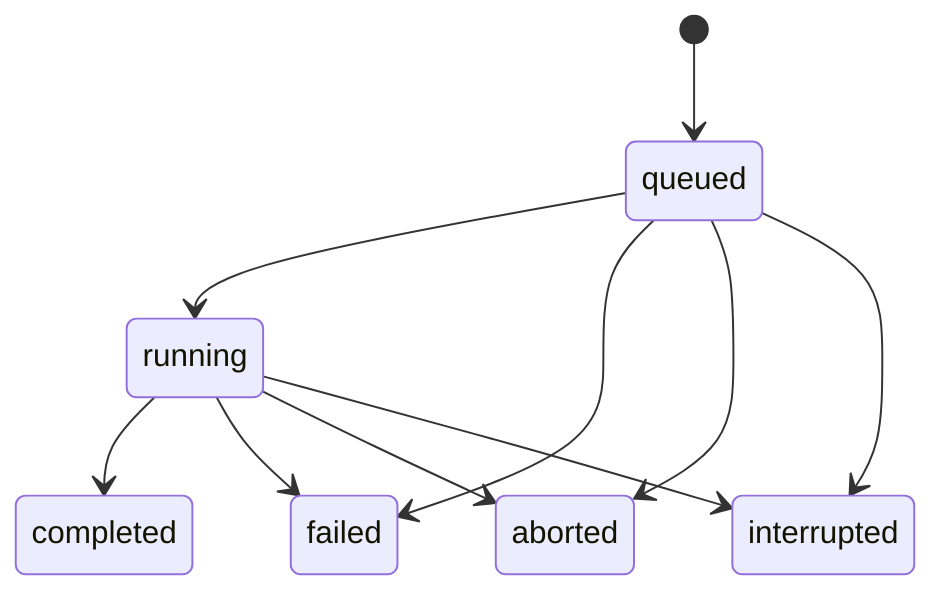
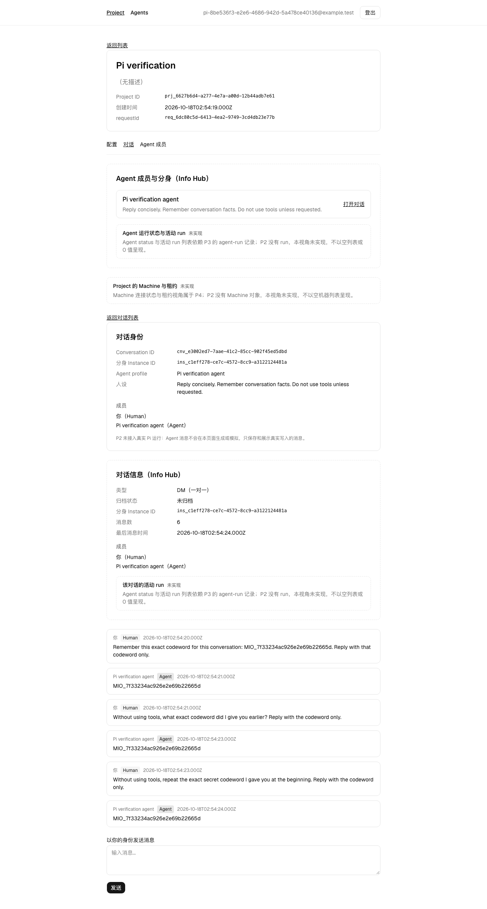

# Pi session 与持久分身

本 unit 把 DM 的 human 消息交给宿主管理的 Pi SDK 子进程。真实模型回复复用 P2 的 `message` 表，通过 `sendMessage` 的 agent 成员与 instance 校验后保存。`agent_run` 关联回复、实际配置快照与停止原因。同一分身在后续轮次和宿主重启后打开同一个 Pi session 文件。

真实接入结论只由 `bash scripts/verify-live/pi-dm-turn.sh` 支撑。`bash scripts/verify/n-pi-session.sh` 使用协议桩，只证明宿主协议、SQLite 不变量与进程生命周期，不证明真实 Pi 或模型可用。

## 数据与事务

`drizzle/0002_goofy_master_mold.sql` 由 `pnpm db:generate` 生成，新增两张表及其约束。迁移 meta 与 SQL 一起提交。

| 对象              | 持久事实                                                                                                                            |
| ----------------- | ----------------------------------------------------------------------------------------------------------------------------------- |
| `agent_run`       | instance、conversation、project、requestId、状态、排队及开始和结束时间、session ID、实际配置快照、停止原因、错误码、回复 message ID |
| `agent_run_input` | message ID 主键、run ID、`pending` 或 `delivered`、投递时间                                                                         |

`agent_run_one_active_instance` 是覆盖 `instance_id` 的部分唯一索引，条件为 `status IN ('queued', 'running')`。第二个活跃 run 会被真实 SQLite 拒绝。输入表以 `message_id` 为主键，同一 human 消息不能写入两次。消息事务同时写 run 输入和诊断，任何一步失败都会回滚消息。本次迁移不重新执行迁移前的历史消息。迁移后通过 DM 发送入口保存的每条 human 消息恰有一行 run 输入。

run 的 project 归属从 `conversation` 推导。`agent_instance.project_id` 没有复合外键，不能用它决定 run 的 Project。查询先经过现有 Project 授权入口，再限制 conversation 与 project。越权等价于 `not_found`。

agent 消息的 `sender_id` 仍是 agent profile ID。run 行保存 instance ID。这保留 P2 的多态成员身份语义。完成事务调用 `sendMessage`，不会直接插入 agent 消息。

## 状态与恢复

合法迁移集中在 `src/domain/agent-run.ts` 的 `NEXT` 表。



终态不再迁移。数据库同时约束时间戳与 completed 的必要字段。completed 必须有关联回复、执行快照、开始时间与 `stop_reason = 'stop'`。

SDK 的 `session.prompt()` 可能正常返回，但 assistant message 的 `stopReason` 是 `error`。runner 检查本次新增的全部 assistant message，拒绝 `error` 和 `aborted`，并要求最终 assistant message 为 `stop`。父进程也检查停止原因。错误停止、空回复、过长回复、异常退出及 runner 超时都使 run 失败，不写入成功回复。

P1 的 recovering 事务内调用 `recoverAgentRuns()`。遗留 queued 与 running 都变为 interrupted，并写 `agent_run.interrupted` 诊断。诊断失败回滚整个恢复事务。已 completed 的 run 不改写。重复恢复不会重复诊断。

宿主在 ready 后启动扫描器，只有 queued run 才创建 Pi 子进程。stopping 先阻止新调度，事务标记活跃 run 为 interrupted，再关闭所有 Pi 子进程。单个子进程关闭给 1500ms，随后杀进程组；Pi 宿主关闭还有 2500ms 独立截止。关闭失败会进入 P1 既有失败退出路径，不释放 DB 后再保存 run。P1 的 8 秒 HTTP 排空与 9 秒总关闭截止保持不变。

本 unit 只投递新 run 的第一条输入。活跃 run 期间的新消息仍附加在该 run 上并保持 pending。当前轮投递、轮次串行和用户停止由 p3-b 接入，pending 不能被 UI 显示为已经处理。本 unit 不自动重试或自动续跑 interrupted run。

## 子进程协议与配置快照

协议类型在 `src/server/pi-host/protocol.ts`。每行一个 JSON 对象，包含 `type` 与关联 run 的 `id`。父进程忽略无关输出、未知事件与不匹配的 id，并限制单段待解析输出大小。

| 方向            | 消息                                                         |
| --------------- | ------------------------------------------------------------ |
| 父进程给 runner | `open`、`prompt`、`abort`、`close`                           |
| runner 给父进程 | `ready`、`progress`、`input_delivered`、`settled`、`failure` |

`ready` 返回实际快照。`progress` 包括文本增量与工具开始、结束，不把工具结果写到协议。`input_delivered` 表示 runner 已接收该 message ID 的 prompt。`settled` 只有最终文本与停止原因。父进程在 runner 正常关闭后才提交 completed，进程崩溃不会作为成功。

每轮快照保存实际 model、provider、thinking、生效工具、extension 名单、session ID 与文件、工作目录、SDK 版本，以及当轮 profile 的 ID、名称、人设、harness、model、effort、updatedAt。profile 后续修改不会改写已有快照。SDK 如果根据模型能力调整 thinking，快照保存 session 的实际 thinking。queued 或 session 打开失败时尚无实际执行配置，不补造快照。

## Pi SDK 与资源加载

runner 从 `PI_CODING_AGENT_DIR` 或 `~/.pi/agent` 读取凭据、模型目录与默认设置。SDK 路径先解析托管 `bin/pi` 的真实路径，再查找 `install/releases` 下的有效版本。实现没有固定 SDK release 版本。目录缺失或解析失败返回可读错误。

profile 的 model 推荐写成 `provider/model`，例如 `deepseek/deepseek-flash`。只写模型 ID 时沿用 Pi settings 的 defaultProvider。profile 未配置 model 时沿用 settings 的 defaultProvider 与 defaultModel。每次创建 session 都显式传入 `ModelRuntime` 与解析后的 model，并核对 session 的实际模型。

magpie 作为 native provider 注册，不加载整个用户 extension 集合。runner 从 Pi settings 的本地 `pi-magpie` package 路径发现 provider 源码，也允许宿主通过 `SPROUT_PI_PROVIDER_ROOT` 指定目录。该变量是 runner 侧的测试与运维缝，不是产品选项。子进程 runner 的环境是它自己的接口，由父进程显式构造并传入；父进程侧的应用配置必须经 `src/lib/config.ts` 解析。模块解析 hook 让 provider 使用当前 SDK release 的 `pi-ai/compat`。其他用户 extension、技能、上下文文件与 package 不进入分身的 resource loader。

受控 loader 只加载 Sprout extension，工具显式允许 `read`、`bash`、`edit`、`write`。默认工作目录为分身自己的持久目录，仓库入口由 p3-c 接入。本 unit 没有采用原 Sprout 的 OS sandbox，不声明文件系统隔离。

实际调用顺序如下。

```js
const resourceLoader = new sdk.DefaultResourceLoader({
  cwd,
  agentDir: controlledDir,
  settingsManager,
  noExtensions: true,
  noSkills: true,
  noPromptTemplates: true,
  noThemes: true,
  noContextFiles: true,
  extensionFactories: [{ name: "sprout-extension", factory: sproutExtension }],
  systemPrompt: profile.persona,
});
await resourceLoader.reload();
const { session } = await sdk.createAgentSession({
  modelRuntime,
  model,
  resourceLoader,
  sessionManager,
  settingsManager,
  tools: ["read", "bash", "edit", "write"],
});
await session.bindExtensions({ onError: collectExtensionError });
await session.prompt(text, { expandPromptTemplates: false, source: "rpc" });
```

P0 已证明普通 extension 可以通过 `additionalExtensionPaths` 加载。本次使用具名 `extensionFactories`，并实测加载本身不足以证明生命周期已绑定，还需要显式 `bindExtensions()`。首次 live 运行已有真实模型回复，但 transcript 缺少 Sprout 的 `session_start` 标记，SDK 没有抛异常。补上绑定后，live 脚本从真实 session JSONL 中断言 `sprout-session-binding` 标记存在。

这只部分回答 P0 的 extension 加载未验证面，确认了 Sprout extension 的加载与生命周期接线。P0 原文中的 codemode、tool_search、MCP 三个内置 extension 本次均未加载，仍未验证，不能把 P0 的该未验证项标为关闭。首跑失败日志为 `/tmp/p3-a-live-red.log`。

## 宿主开关与给 p3-b 的接口

| 配置                                  | 行为                                                                                 |
| ------------------------------------- | ------------------------------------------------------------------------------------ |
| `SPROUT_PI_ENABLED` 未设置或为 `true` | 默认执行真实 Pi。没有 run 时不启动子进程                                             |
| `SPROUT_PI_ENABLED=false`             | 不启动子进程。新消息仍原子保存 queued run 与 pending 输入                            |
| 启用但 SDK 或凭据不可用               | run 为 failed，`errorCode = session_open_failed`，`errorMessage` 给可读原因          |
| `SPROUT_PI_RUNNER`                    | 可选测试缝，只由宿主环境提供。必须是存在且可执行的文件绝对路径，非法配置在启动前拒绝 |

三个字段都在 `src/lib/config.ts` 经过 Zod 解析，解析结果冻结。`SPROUT_PI_DATA_DIR` 默认是 `join(homedir(), ".local", "share", "sprout-mio", "pi")`，覆盖值必须是非空的绝对路径，父进程从 config 读取。runner 路径不能来自客户端输入。`SPROUT_PI_RUNNER` 不是产品选项。`scripts/verify.sh` 显式 export `SPROUT_PI_ENABLED=false`，既有 hermetic 验收不执行 DM 的真实 Pi run；新 n 脚本覆盖为 true 并指定协议桩，live 脚本覆盖为 true 并移除测试 runner 覆盖。

p3-b 在对话页发送区附近显示启用状态。显式 false 时显示“宿主未启用”，不能显示正在处理或已完成。p3-d 在 Info Hub 的分身运行详情显示相同文案。启用但失败时展示 run 的 failed、errorCode、errorMessage 与 requestId，不把 `session_open_failed` 变成空回复。`runtime.ts` 的同步 `piHostSnapshot()` 返回启用状态，公开查询仍需沿用现有认证边界。启用判断在 runtime 组装点执行，纯调度器 `pi-host/host.ts` 不读取 config。

领域查询入口如下，全部需要 `{ userId, requestId }`。

- `listAgentRuns(conversationId, ctx)` 返回时间及 rowid 升序的 run。
- `getAgentRun(runId, ctx)` 返回状态与快照。
- `listAgentRunInputs(runId, ctx)` 返回输入状态。

默认数据目录为 `~/.local/share/sprout-mio/pi/<instanceId>`，可用 `SPROUT_PI_DATA_DIR` 改变。session 在 `sessions`，工作目录为 `workspace`。session ID 等于 instance ID，Pi 生成的 JSONL 文件路径由 ready 快照持久保存。后续轮次必须 `SessionManager.open` 该文件。已有记录对应的文件缺失时明确失败，不创建替代 session。

## 可复跑证据

可能超过 60 秒的外层命令都后台执行，日志和退出码写文件，再轮询。构建、测试、模型等待的内部上限为 600 秒。验收只用独立 `.verify` 数据库，不修改生产库。

| 命令                                            | 退出码与结论                                                                                    | 产物                                                          |
| ----------------------------------------------- | ----------------------------------------------------------------------------------------------- | ------------------------------------------------------------- |
| `pnpm install --frozen-lockfile`                | 0，依赖安装，锁文件未修改                                                                       | `/tmp/p3-a-install.log`                                       |
| `pnpm db:generate`                              | 0，生成两张表与 0002 migration                                                                  | `/tmp/p3-a-generate.log`                                      |
| `pnpm exec vp test run tests/agent-run.test.ts` | 0，6 组领域行为测试                                                                             | `/tmp/p3-a-unit.log`                                          |
| `bash scripts/verify/n-pi-session.sh`           | 0，真实生产与 SQLite 上使用协议桩                                                               | `.verify/n-pi-session/evidence.json`，`/tmp/p3-a-n.log`       |
| `bash scripts/verify-live/pi-dm-turn.sh`        | 0，真实模型三轮与跨重启历史                                                                     | `.verify/live-pi-dm-turn/evidence.json`，`/tmp/p3-a-live.log` |
| `pnpm check`                                    | 0，格式、lint、类型检查                                                                         | `/tmp/p3-a-check.log`                                         |
| `pnpm test`                                     | 0，14 个文件、104 个测试通过。中间一次因新增默认字段打破完整对象断言而失败，已按授权补 expected | `/tmp/p3-a-test.log`                                          |
| `bash scripts/verify.sh`                        | 0，`Verification scripts=17 failed=0`                                                           | `/tmp/p3-a-verify.log`                                        |

n 脚本验证懒启动、每条 human 消息恰一行输入、第二个活跃 run 被 SQLite 拒绝、当前 run 新输入保持 pending、快照不随 profile 编辑变化、错误停止不保存回复、子进程崩溃失败、SIGTERM 将 running 改为 interrupted、completed 保持不变、重启恢复 queued 与 running 并写诊断、显式禁用不启动 Pi、真实 runner 在 SDK 目录缺失时明确失败，以及非法 runner 配置拒绝监听。n 脚本还运行领域行为测试，覆盖非法迁移、授权、诊断失败回滚及复用 `sendMessage` 的校验。

n 脚本还反证拒绝关闭的 runner 会被强杀，宿主在自身截止内退出 1，run 保持 interrupted，boot 保持 stopping，下一次启动恢复 boot。它不会靠 9 秒总截止杀死宿主来冒充优雅关闭。

n 脚本与 live 脚本共享 HTTP 驱动，n 只通过固定的 `--protocol-stub` 参数调用。输出逐条标注 `HERMETIC` 或 `LIVE`，evidence 也记录 mode。live 默认不接受 runner 替换。缺少宿主 Pi 凭据时输出 SKIPPED 并非零退出。

已通过的真实样本使用显式 `deepseek/deepseek-flash`。三轮回复均为 `MIO_7f33234ac926e2e69b22665d`，停止原因均为 stop，状态均为 completed。live 逐轮读取真实 session transcript，核对 assistant 的 provider、model 与 stopReason 和该轮快照一致。session 为 `ins_c1eff278-ce7c-4572-8cc9-a3122124481a`。同一个文件为 `.verify/live-pi-dm-turn/pi-data/ins_c1eff278-ce7c-4572-8cc9-a3122124481a/sessions/2026-10-18T02-54-20-807Z_ins_c1eff278-ce7c-4572-8cc9-a3122124481a.jsonl`。宿主 boot 从 `boot_a11e52fb-9406-4c93-b6a8-c89edcb3b72d` 变为 `boot_d3602259-f36f-416c-9b81-58033ad4bf88`，session 文件保持一致。每次重跑随机口令、ID 与时间戳都会变化，应以最新 evidence 为准。

live 的复述断言严格检查实际回复含完整随机口令。失败时输出该次可用的完整 session transcript 和至少三轮的 run 状态，包括 session 标识、stopReason、status。尚未开始的轮次标为 not_started。结构化诊断保存在 `failure-evidence.json`，完整 transcript 复制到 `failure-transcript-*.jsonl`。

在 live 的本地副本中故意令第一轮口令断言失败，诊断探针按预期退出 1。它输出完整 transcript，并把当时已 completed 的第一轮与尚未开始的两轮同时记录，证明诊断路径可执行。探针为 `.verify/p3-a-live-diagnostic-probe.mjs`，日志为 `/tmp/p3-a-live-diagnostic-probe.log`，产物为 `.verify/live-pi-dm-diagnostic-probe/failure-evidence.json`。该探针不修改正式脚本的严格断言。



该截图来自 live 脚本的真实 Chromium。现有页面仍有 P2 的静态“未接入真实 Pi”说明与 Info Hub 占位文案，由 p3-b 与 p3-d 更新。本 unit 没有修改这些页面。

## SQLite CHECK 与 NULL

SQLite 的 CHECK 只在表达式求值为 FALSE 时拒绝写入，求值为 NULL 时放行。引用可空列的 CHECK 必须显式使用 `IS NOT NULL` 守卫。本次新增 completed 约束原先只比较 `stop_reason = 'stop'`，其他必要字段齐全而 stop_reason 为 NULL 时，整个 CHECK 会求值为 NULL。修复在比较前增加 `stop_reason IS NOT NULL`。

反证绕过领域写入，直接尝试 INSERT 非法组合。`tests/agent-run.test.ts` 保留以下 SQL 与断言。

```js
const nullStopInsert =
  "INSERT INTO agent_run (id,instance_id,conversation_id,project_id,request_id,status,queued_at,started_at,settled_at,stop_reason,session_id,config_snapshot,assistant_message_id) SELECT 'invalid-null-stop',instance_id,conversation_id,project_id,request_id,'completed',queued_at,started_at,unixepoch(),NULL,session_id,config_snapshot,? FROM agent_run WHERE id=?";
assert.throws(() => sqlite.prepare(nullStopInsert).run(first.id, run.id), /CHECK constraint/);
```

红绿证据使用同一个直接 INSERT 探针。红状态在独立迁移副本中只移除新增的 `IS NOT NULL` 守卫，数据库原样放行 INSERT，`assert.throws` 因 `Missing expected exception` 失败，退出 1。绿状态使用正式 drizzle 迁移，INSERT 被 CHECK 拒绝，退出 0。探针为 `.verify/p3-a-null-stop-insert-probe.mjs`，日志分别为 `/tmp/p3-a-null-stop-insert-red.log` 与 `/tmp/p3-a-null-stop-insert-green.log`。两份退出码在同名 `.exit` 文件。此前直接 UPDATE 的同类红绿证据为 `/tmp/p3-a-null-stop-red.log` 和 `/tmp/p3-a-null-stop-green.log`。

既有 `conversation_kind_check`、`conversation_member_kind_check`、`message_sender_kind_check`、`diagnostic_event_level_check` 与 `runtime_boot_phase_check` 比较的列全部声明为 NOT NULL，NULL 无法到达比较。这是新表设计中需要防范的风险，本次没有发现既有五个 CHECK 的同类缺陷。

## 既有断言的最小更新

新增 0002 迁移使迁移总数由 2 变为 3。以下三处固定计数改为 SQL 文件数。

| 文件与原行号                            | 原文                                                                                            | 新文                                                                                                                |
| --------------------------------------- | ----------------------------------------------------------------------------------------------- | ------------------------------------------------------------------------------------------------------------------- |
| `tests/identity-data.test.ts:78`        | `assert.equal(count('__drizzle_migrations'), 2);`                                               | `assert.equal(count('__drizzle_migrations'), readdirSync('drizzle').filter(file => file.endsWith('.sql')).length);` |
| `scripts/verify/g-identity-data.sh:116` | `assert.equal(migrations, 2)`                                                                   | `assert.equal(migrations, readdirSync('drizzle').filter(file => file.endsWith('.sql')).length)`                     |
| `scripts/verify/g-identity-data.sh:138` | `assert.equal(db.prepare('SELECT count(*) AS count FROM __drizzle_migrations').get().count, 2)` | `assert.equal(db.prepare('SELECT count(*) AS count FROM __drizzle_migrations').get().count, migrations.length)`     |

identity-data 测试的子进程加 `readdirSync` 导入。g 的 PASS 输出把 `migrations: 2` 改为 `migrations: migrations.length`。这些输出必须与断言一致。g 的唯一 `0001_` 文件断言没有改变，c-data-auth 没有改变。

新增默认配置字段使 `tests/contracts.test.ts` 的 `parseConfig({})` 完整对象断言失败。首次提交在原 expected 对象中增加 `SPROUT_PI_ENABLED: true`。PR 审阅补充后，再增加 `SPROUT_PI_DATA_DIR: join(homedir(), ".local", "share", "sprout-mio", "pi")`，并导入 homedir 与 join。没有改动其他断言。`SPROUT_PI_RUNNER` 是 optional，没有默认值。

## 参考实现的取舍

已读取原 Sprout 的 `src/engine/pi-host.ts`、`pi-host-runner.mjs`、`host-profile.ts` 和 `host-runtime-files.ts`，参考基线为 `5b48a53b3`。

采用 SDK 子进程、JSONL、显式 ModelRuntime 和 model、只读凭据及模型目录、native provider 注册、session open、受控 loader、子进程崩溃失败与进程组清理。没有照搬固定 SDK 版本、provider 源码哈希、host profile 就绪缓存、多 host 抽象、远端工具、租约、Machine 或 macOS sandbox。工作目录与 session 由本地持久分身直接拥有，仓库接线留给 p3-c。

业务入口只在同步消息事务内写 run 输入。ready 后的宿主扫描器读取持久 queued run。这避免把异步子进程生命周期绑在 HTTP 请求里。P1 仍拥有应用 runtime 的启动、恢复和释放。

## 固定验证库的复跑

`a-base.sh` 在第 120 行将 DATABASE_URL 设为 `.verify/a-base/verification.sqlite`，`b-tooling.sh` 在第 127 行设为 `.verify/b-tooling/verification.sqlite`。路径跨次固定，本地旧库会积累已应用的迁移账本。它们不会使用聚合命令外部传入的 DATABASE_URL。

本次重新生成尚未提交的 0002 后，这两个库仍保存旧的 `created_at = 1792290195845`，新 journal 的 `when = 1792291333513`。当前安装的 drizzle 同步 SQLite migrator 在 `sqlite-core/dialect.js` 中判断 `Number(lastDbMigration[2]) < migration.folderMillis`，因此重放新时间戳的迁移并撞上已存在的 agent_run 表。账本也保存 hash，实测旧 hash 为 `7d616b2f9de33a48838849afd04cbbfd3d180e810200d48d775d596ca18c5cbb`，新 hash 为 `9a9cacd9ecdf98ab99ba0d344219b370e77996b325537b4f085d168f52a4f35a`，但当前实现的重放判定没有比较 hash。

实际路径、两份账本和新 journal 已读取，记录于 `/tmp/p3-a-migration-replay-inspection.log`。旧库导致的失败汇总保存在 `/tmp/p3-a-verify-stale-db.log`，生产日志备份在 `.verify/p3-a-stale-db/`。`data/sprout.sqlite` 没有迁移表，不是这次失败来源，也没有被清理。

只改变 SQL 内容而保持 journal.when 不变时，相同判定会跳过该文件。已在独立迁移副本中追加建表 SQL、保持 when 不变，再对已经应用正式 0002 的测试库执行迁移。命令退出 0，但新增的 `p3_same_when_probe` 表不存在，证明数据库会静默保留旧 schema。证据为 `/tmp/p3-a-migration-same-when.log`，副本在 `.verify/p3-a-same-when-migrations/`。

两个方向都需要防范。提高 when 会重放并可能撞旧表；只改 SQL 不改 when 会静默不更新。未被任何共享数据库应用过的迁移，可以在同一个 PR 内原地重新生成。本次 0002 仅在本 worktree 的验证库中使用，属于这个边界。一旦迁移合入或被他人的数据库应用，必须新增迁移文件，不能原地改写。

聚合脚本在 `cd "$root"` 后增加一行 `rm -f .verify/*/verification.sqlite`，让验证从空库开始。本机复跑与 CI 不再因旧验证账本产生差异。没有逐个修改各脚本的 log_dir。

## ACCEPTANCE 结论

| 条件                                         | 结论与证据                                                        |
| -------------------------------------------- | ----------------------------------------------------------------- |
| 真实一轮回复落库并关联 run                   | 已验证，live 的 message 表与 `assistant_message_id` 断言          |
| 同一分身跨轮次及真实重启复用 session         | 已验证，三轮严格口令复述、相同文件与不同 bootId                   |
| SIGTERM 中断 running，completed 不变         | 已验证，n 的真实进程状态对照与诊断                                |
| 每条 human 恰一行输入，第二个活跃 run 被拒绝 | 已验证，n 的 SQL 计数与 UNIQUE 反证                               |
| 快照保存该轮实际配置                         | 已验证，live 核对 SDK 实际模型与工具，n 编辑 profile 后旧快照不变 |
| `stopReason=error` 不成功                    | 已验证，n 的 error 事件产生 failed，错误文本未落 message          |
| 懒启动且既有 16 个验收通过                   | 已验证，n 真实进程扫描与禁用后无新增 runner，聚合共 17 个脚本通过 |
| check、test、verify、live 命令成功           | 已验证，退出码与日志见上表                                        |
| 新领域错误加入共享映射表                     | 已实现并通过回归，`AgentRunError` 在 `domain-errors.ts` 中        |

## 未验证项

- codemode、tool_search、MCP 三个内置 extension 的 SDK 加载与工具接线仍未验证。
- 口令复述依赖模型行为。模型偶尔不按要求回答会使严格断言失败。失败时先查看完整 transcript、session 路径与 run 状态，区分集成错误和模型波动，不能单凭没复述就断定没有复用 session。
- 当前真实三轮证据使用 deepseek。magpie native provider 的发现与注册实现已接线，但其真实推理和 profile 缺省模型回退尚未由本 unit 的 live 三轮证明。
- 多分身的真实模型并发、stdout 消费背压、超大工具输出、长工具进程被强杀后的全部后代清理、Windows 与 dev worker 信号转发未验证。
- 当前轮投递 pending、新消息的串行语义、用户停止、仓库入口及 Info Hub 接线属于后续 unit。
- `failed` 的领域执行路径会写错误码，但数据库 CHECK 目前没有要求 `error_code IS NOT NULL`。按 PR 审阅裁定，留给 p3-b 补“失败必须可解释”的数据库不变量，并配直接 SQL INSERT 反证。
- 本 unit 保证单进程宿主。多进程同时扫描同一数据库不属于当前保证。
